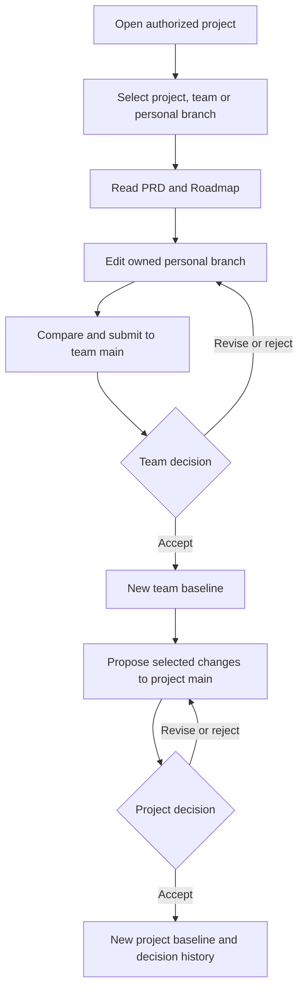
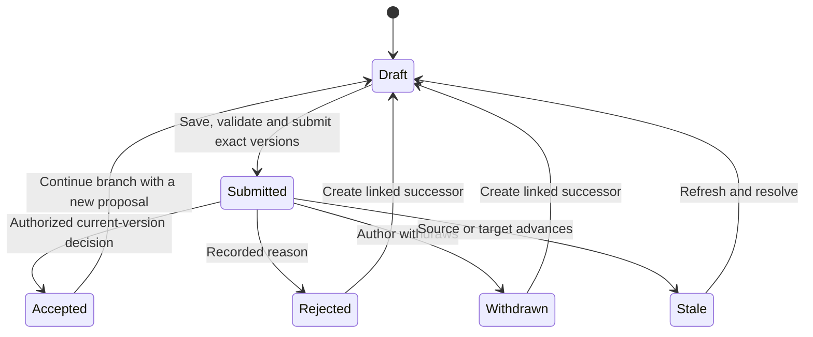

# Projects requirements

[简体中文](PRD.md)

Document revision: 2 · Updated: 2026-11-20 · Status: proposed requirements, not an application release.

| Revision | Date | Author | Change |
| --- | --- | --- | --- |
| 1 | 2026-11-19 | Product owner and maintenance agent | Establish project, four-team and personal planning branches. |
| 2 | 2026-11-20 | Product owner and maintenance agent | Structure the requirements for review: roles, target-scoped proposals, states, validation, recovery and acceptance. |

## 1. Overview: why and for whom

### 1.1 Current situation and intended outcome

Projects currently manages project goals, work items, dependencies and source references in independent spaces. It has a native reader, four work domains, signed business operations, revision checks, idempotent writes and change events. Its current source does **not** implement the planning branches, PRD/Roadmap panels or proposal acceptance specified below. This delivery updates documentation only.

The existing work views explain execution but do not provide a shared, versioned agreement about why a project exists, what is in scope and which milestones the team has committed to. The product owner has requested one project main branch, four team main branches and personal branches. PRD and Roadmap are the primary planning panels; the version engine supplies comparison, history and controlled changes beneath them.

The outcome is a common plan that people can inspect while members and their authorized agents explore alternatives independently. Routine drafting, validation and comparison should run within existing authorization without mandatory human clicks. Consequential scope, commitment and acceptance decisions go to the designated business decision-maker. Opening a page is never approval, and a recorded decision by one owner is not represented as unanimous agreement.

| Goal | Observable success | Measurement boundary |
| --- | --- | --- |
| Understand the current agreement | A participant can identify the current project/team baseline, its owner, commitments and unresolved questions. | Verify the representative reading task; do not infer understanding from page views. |
| Change the plan without silent loss | Independent proposals preserve unrelated changes; stale acceptance and unauthorized writes produce no change. | All mandatory acceptance cases in §5.1 pass before release. |
| Reduce coordination effort | Compare human handling time and clarification/rework per accepted plan change with the previous workflow. | No measured baseline or numerical improvement target exists yet; collect an explicitly agreed pilot baseline rather than inventing a benefit. |

### 1.2 Users, terms and responsibilities

Intended users are project decision-makers, leads of the research/engineering/marketing/support teams, team members, readers and external agents acting for those people. App authors, designers and testers use this document to implement and verify the contract.

| Term | Meaning |
| --- | --- |
| Project main | The project's accepted PRD and Roadmap, including explicitly adopted team contributions. |
| Team main | One team's accepted plan and its relationship to project goals and constraints. There are exactly four team mains per project. |
| Personal branch | One continuing draft branch per project, team and authenticated user; it isolates proposed changes. |
| Baseline | An explicitly adopted immutable planning version. An empty or unadopted projection is not agreement. |
| Proposal | A bounded set of intended changes to a named target plan, with source evidence, versions and impact. |
| Acceptance | An authorized business decision that applies the reviewed proposal to its target and records a new baseline. |
| Execution fact | App-owned progress, completed work, delivery or recorded acceptance that a planning change cannot erase. |

The hierarchy is **one project main + four team mains + the actual personal branches**, never four total branches or four assumed people. A person participating in two teams has separate personal branches in those teams under default A1 (§5.2); personal identity comes from authentication, not an input name.

| Role | Permitted behavior, subject to current resource/action grants | Boundary |
| --- | --- | --- |
| Reader | Read authorized plans, comparisons and decisions. | No draft or baseline writes. |
| Team member | Create/reuse and edit their personal branch; submit or withdraw their own proposal. | No edit of another person's branch; no direct baseline replacement. |
| Team lead or explicit delegate | Accept/reject proposals targeting their team; propose an accepted team contribution to project main. | Cannot accept project-level changes solely because they lead a team. |
| Project decision-maker or explicit delegate | Adopt the initial project baseline and accept/reject proposals targeting project main. | Authority is explicitly assigned for this project. |
| External agent | Perform only the user's currently delegated operations, including acceptance only when separately and explicitly delegated. | No independent role or self-declared owner/manager. |
| Platform maintainer/administrator | Maintain code, deployment and protected account/permission controls. | Platform status alone confers no business acceptance authority. |

Acceptance requires both the designated target decision role and current scoped write/acceptance authorization. An ordinary write grant alone is insufficient. Role assignment must be protected and auditable; it cannot be smuggled into a proposal or taken from the legacy free-text owner label. Concrete account mapping is decision D1 in §5.2.

## 2. Product scope and overall flow

### 2.1 Scope, priorities and release boundaries

| Priority | Capability | Delivery status |
| --- | --- | --- |
| Existing | Independent app/native renderer; project and work-item reader; dependencies, references, revision/idempotency contracts; authorized Praxis cards/data inventory. | Existing source contract; preserve it. |
| P0 | Project/four-team/personal hierarchy; PRD and Roadmap; identity-owned drafts; parent-targeted proposals; compare, accept/reject/withdraw/resubmit; conflicts; immutable decision history; authorization and recovery. | Proposed; implementation and acceptance Pending. |
| P1 | Restore an earlier plan into a new draft/proposal and enhance historical comparison. | Proposed follow-up after the complete P0 loop. |
| Outside first release | Arbitrary team structures, arbitrary branch graphs, Git repository operations for business records, automatic resource reservation and automatic rollback of real-world actions. | Not part of the initial implementation. |

No implementation release date or team capacity has been confirmed. The current task delivers a reviewable PRD and matching roadmap, not a working branching service. Historical source publication or tests do not establish new functionality.

### 2.2 Main flow and information ownership

From the workbench, open an authorized project and select a branch. Read its PRD and Roadmap. To change a baseline, create/reuse an owned personal branch under the relevant team, save a draft, inspect the target change and impact, then submit it to that team. After team acceptance, a team lead can propose selected project-level changes to project main. The project decision-maker reviews and accepts or rejects that proposal.

Each branch has its own PRD and Roadmap at its scope. Team plans explain how that team contributes to project goals and retain team-specific context. **Every proposal describes changes to its target plan.** A personal-to-team proposal changes the team plan; a team-to-project proposal identifies the project fields, goals, milestones or commitments to change and cites the accepted team source revision. It never replaces the project's entire PRD with team prose. Team items promoted upward retain team-qualified stable IDs and provenance.

Synchronizing parent context refreshes inherited references and reveals impacts. It does not overwrite a team's own plan with project prose. Each pending proposal captures its target baseline explicitly; a branch's ancestry alone is not permission to merge.

Projects owns plans, branches, proposals and decisions. Existing work-item and reference operations remain the source of execution records. Referenced Knowledge documents and deliverables stay in their owning apps; a link or proposal cannot widen their access. Web and MCP use the same typed app operations and authorization rules.

### 2.3 State model and global interaction

Branches continue across multiple proposals. Proposal state and branch identity are separate. Project/team panels are read-only baselines; a change starts in the member's personal branch or in a bounded upward proposal prepared from an accepted team revision.

| Object/state | Visible meaning | Allowed transition |
| --- | --- | --- |
| Baseline: unadopted | No approved initial plan exists. | Explicit target-authorized adoption creates the first baseline. |
| Personal draft | Saved or unsaved work has not changed a baseline. | Save, compare, sync or submit after validation. |
| Proposal: submitted | Exact source/target versions await the target's decision. | Accept, reject, withdraw or mark the review stale. |
| Proposal: accepted/rejected/withdrawn | A recorded terminal decision; its content and reason remain immutable. | A new linked proposal may follow; do not rewrite the old decision. |
| Review: stale | Source or target advanced after submission/review. | Refresh comparison, resolve if necessary and submit a new reviewable version. |
| Editor: unsaved/saving/saved/conflict/uncertain | Local persistence status, separate from business agreement. | Recover as specified in §3.6; never label an uncertain save as accepted. |

Only one active submission per source/target pair is allowed. A new submitted version supersedes the prior review while retaining its evidence. Opening, polling, switching panels or returning Home never accepts or completes a business object. Lists preserve stable identity and explicit order; saved milestones use their declared order, proposals show current submissions first and history newest first with pagination. Data arrival must not move keyboard focus or destroy an editor draft.

## 3. Functional requirements

### F01. Select scope and adopt baselines

**Story:** As a participant, I need to know which project/team/branch I am reading so that I can distinguish shared agreement from personal proposals.

The native project entry and branch selector expose project main, exactly four team mains (`research`, `engineering`, `marketing`, `support`) and personal branches within the current grant. Show scope, branch owner, parent/context revision, adoption state and pending changes. Preserve a validated project/space/branch/panel deep link and the workbench Home return on desktop and phone widths. Branch names do not grant permissions.

Existing projects retain their goals, work items, dependencies and references. Opening one may show empty/unadopted baseline slots without writing records. It must not invent members, personal branches, commitments or retrospective decisions. Initial adoption requires an explicit authorized action, reviewable initial content and a recorded decision. Missing decision authority leaves the baseline unadopted and explains the next step; it never falls back to platform-admin status.

### F02. Create a personal branch and maintain its PRD

**Story:** As a team member, I want an isolated draft based on the selected team context so that I can propose a change without altering the team's accepted plan.

Create/reuse the branch for the signed-in user and authorized team; record the parent context/version. PRD content covers problem, outcome goals, scope, exclusions, acceptance criteria, open questions, decisions and source references. Stable goal/criterion IDs let Roadmap items refer to them. Drafts may contain incomplete narrative, clearly marked as incomplete. Submission requires a purpose, nonempty changed content, a target and impact statement; it must identify unresolved acceptance or commitment questions for review.

The editor labels the scope and baseline being edited, shows field validation beside the field, preserves changes during refresh/navigation and confirms only a server-acknowledged save. Another user cannot edit this branch by knowing its ID or setting an owner field. Repeated create/save with the same intent produces one result. Adopting or accepting a baseline requires a nonempty problem and scope, at least one goal and at least one acceptance criterion; optional exclusions and unresolved questions may remain explicitly unspecified. A proposal that removes the last required item cannot be accepted.

### F03. Maintain a Roadmap linked to the PRD

**Story:** As a participant, I want stages and milestones linked to goals and acceptance so that dates and priorities have an understandable purpose.

Use the same branch/scope as the PRD. Milestones show title, goals/criteria, priority, planning status, owner, dependencies, planned date when known and whether the arrangement is tentative or committed. Unknown owners/dates remain explicit unknowns. A plan date is not a delivery guarantee; a `done` planning marker is not proof that an execution work item or customer acceptance occurred.

Changing a goal, scope or criterion exposes linked milestone impacts before submission. Reject dangling goal/criterion/dependency references and cycles. A committed milestone requires an accountable assignee, an acceptance criterion and explicit decision authority for the commitment; its planned date may remain unknown but is displayed as such. Removing a referenced goal or milestone requires updating its dependents in the same proposed change, never dropping those relationships silently. Existing work-item state remains unchanged unless separately updated through its owning authorized operation.

### F04. Compare, submit and decide on a target-scoped proposal

**Story:** As an author or target decision-maker, I need to see exactly what would change and why so that acceptance is informed and attributable.

Comparison shows source branch/revision, captured target baseline, current target revision, additions/changes/removals and impacts on goals, dependencies, commitments and acceptance. Preserve source evidence and unresolved questions. A team-to-project proposal selects project-level changes and keeps unpromoted team detail in the team plan. Empty changes cannot be submitted. Baseline creation is explicit adoption, not an empty merge.

Submitting freezes the proposal content and reviewed source/target versions. The target decision-maker can accept or reject with a recorded reason; the author can withdraw. Acceptance rechecks current identity, delegation, target role, resource/action grants and both versions in the same commit boundary. Non-overlapping changes may be combined, but publication still requires the target's authorized decision. A proposal cannot modify membership, role assignments, another personal branch or execution facts.

Acceptance creates one new target baseline and one durable decision, returns the actual versions and can be read back in the panels. Rejection/withdrawal changes no baseline. Subsequent editing cannot mutate the accepted/rejected snapshot; a revised successor points to the earlier proposal. Users can continue their existing personal branch instead of creating a new branch for every change.

### F05. Resolve conflicts and synchronize context

**Story:** As an author or authorized reviewer, I need to preserve both sides of a disagreement so that concurrent work cannot be silently overwritten.

Detect a conflict when the same target field or stable item changed incompatibly from the captured target baseline. Show base, current target and proposed values with provenance. Independent changes retain both sides. Two teams' items with the same local slug remain distinguishable by team-qualified identity. A text merge does not resolve contradictory goals, capacity promises or acceptance rules: record the open question, decision owner and effect.

The author or authorized target maintainer records an explicit resolution and reason. A reviewer does not acquire direct edit rights to the author's branch: a suggested resolution is a new reviewable change. Refresh the target/source comparison and resubmit before acceptance. A stale version rejection causes no baseline write. Parent synchronization preserves local edits and team-specific meaning, and flags conflicts/impacts instead of silently copying or discarding content.

### F06. Read history and recover failures

**Story:** As a participant, I want the accepted plan and the decisions behind it to remain explainable after retries, restarts or changes in personnel.

Retain saved proposal versions, accepted baselines, decisions, actors, reasons, source/target revisions and evidence references. A history detail opens the original authorized PRD/Roadmap version. Label missing history and mutable/unversioned sources honestly; recheck current source access when following a link. Restoring an older plan (P1) creates a new personal draft and follows ordinary review; it never rewinds execution facts or erases intervening decisions.

| Condition | Required feedback and recovery |
| --- | --- |
| Loading or no plans | Show loading separately from an empty/unadopted state; offer the authorized next action. |
| Invalid field/reference | Identify the field or relationship; keep the draft and return focus to correction. |
| Read-only or target decision role absent | Keep permitted reading available; explain which operation is unavailable, without exposing inaccessible identities or plans. |
| Permission revoked/session expired | Reject the write, stop further reads, clear protected content from the view and browser draft cache, and provide sign-in/access recovery. Server-saved branches/history remain under the app's retention policy. |
| Network failure before a known commit | Preserve the local draft and distinguish unsaved from saved. |
| Timeout/unknown outcome | Mark uncertain; read back using the same authorized object/intent and retry the identical request with the same key only when needed. Never create a second intent to hide uncertainty. |
| Source/target changed | Show stale/conflict state, retain local content, refresh and require a new review. |
| Refresh, switch branch or return Home with a draft | Preserve an authorized draft or offer explicit save/discard/stay; never silently discard. Local draft storage is identity-scoped and cleared on sign-out/revocation. |
| Parent/source temporarily unavailable | Keep the permitted saved plan readable, identify unavailable evidence and prevent acceptance that requires unverified versions. |

### 3.7 Proposed data dictionary and validation

These are product field rules for the proposed release, not implemented HTTP/MCP schemas. All identifiers and timestamps described as server-owned are not editable. Reject unknown fields and invalid types on the server; a whole-record JSON replacement is not a business operation. Narrative is plain text, not executable HTML or code.

| Object/field | Type and requirement | Rule/example |
| --- | --- | --- |
| Scope: `spaceId`, `projectId`, `branchId` | Required stable IDs | Resolve within the current grant; project IDs keep the existing app format. |
| Branch: `kind`, `teamId`, `ownerUserId` | Required enum; team/owner nullable by kind | `project`, `team`, `personal`; team is one of the four fixed domains; personal owner is the authenticated user. |
| Branch/proposal revisions | Required server-owned version IDs | Distinguish source head, captured target and reviewed target; compare exact IDs, not dates. |
| PRD: `problem`, `scope`, `outOfScope` | Plain text; draft may be empty | Up to 10,000 characters per field; problem/scope are nonempty in an accepted baseline; empty optional exclusions mean unspecified. |
| PRD: goals and criteria | Arrays of stable `{id,text}` items | Up to 100 each; text 1–2,000 characters; criterion-to-goal links must resolve. |
| PRD: questions and decisions | Stable records with text, owner/ref and state | At most 100 of each, text 1–2,000 characters; questions distinguish open/resolved and may have an unassigned owner; resolved questions link a recorded decision. No fabricated answer or owner. |
| Milestone: `id`, `title`, goal/criterion links | Required stable ID, title and valid links on submission | Title 1–160 characters; IDs qualified by origin team on promotion; at most 200 milestones per branch. |
| Milestone: `status`, `priority`, `commitment` | Required enums | Status `todo/doing/review/done`; priority `P0/P1/P2`; commitment `tentative/committed`. These describe planning only. |
| Milestone: `ownerUserId`, `dueDate`, `dependsOn`, order | Nullable authorized user/date, ID list, integer | Date is a real `YYYY-MM-DD` or null; dependencies unique, at most 100, no self-reference/cycle; order is nonnegative. |
| Proposal: target and changes | Required scope, operation list and source refs | 1–200 bounded operations on allowed PRD/milestone items, not arbitrary paths; target and source remain within authorized hierarchy. |
| Proposal: purpose, impact and decision reason | Plain text; purpose/impact required on submission, reason on decision | Nonempty, at most 2,000 characters each; impact identifies changed commitments and unresolved issues. |
| Evidence reference | Authorized object reference and version when available | Never a permission grant; an unversioned source is explicitly marked as such. |
| Decision/history: actor, time, result and versions | Required server-owned records | Preserve original user and delegated client reference; terminal decisions cannot be rewritten. |
| Mutation: expected versions and intent key | Required on writes | Stable key for the same intent; changed payload with the same key is rejected. |

Text validation rejects unsupported control characters. Names/IDs must not impersonate a role. Invalid calendar dates, out-of-range enums, unknown links, duplicate IDs and excessive sizes fail without partial persistence. An unsaved draft may display incomplete fields, but a committed mutation must be structurally valid; a submitted or accepted plan must also satisfy the applicable relationship and completeness rules. Proposed limits are defaults for review; changes to them must update both language editions and acceptance fixtures.

## 4. Nonfunctional requirements

### 4.1 Authorization, storage and integration

Preserve the independent Projects application and its native renderer when hosted by Praxis. Keep existing work views, references, per-project deep links, language choice and Home navigation. Reuse one branch-aware renderer with typed data across all projects and scopes. English and Simplified Chinese product copy agree; user-authored content keeps its original language. Keyboard, loading/error recovery and phone widths are required.

The application owns private business storage outside Git and images. Use a single active writer with atomic baseline/decision persistence, durable idempotency and recoverable app history. Physical tables, indices and migration design belong to the implementation proposal. Do not import existing private data into fixtures or run a live content migration under maintenance identity. Preserve existing schema compatibility and registered backup coverage; no automatic history deletion is introduced. Applicable retention/deletion policy remains D2 in §5.2.

Native web and MCP must enforce the same bounded operations, grants, revisions and read-back behavior. Document each newly exposed tool in the operation-specific Projects business skill before advertising it. Current operation names are not proof that proposed operations exist. A referenced app becoming unavailable cannot fabricate a verified source. Keep app-owned Praxis cards and data-inventory provider behavior, native paths, source revisions and empty/partial/unavailable distinctions; personal card choices never change shared plans.

### 4.2 Business evidence and measurement

Record the authoritative lifecycle for branch creation, saved proposal versions, submission, decision, merge/conflict and recovery. Business evidence uses the authorized project retention/access boundary and links the real actor, source/target versions and safe decision references. Diagnostic aggregates contain only allowlisted operation category, outcome, duration and opaque correlation references; never PRD bodies, raw arguments, credentials, arbitrary errors or private reading history.

| Event family | Trigger and allowed evidence | Use |
| --- | --- | --- |
| Branch/draft | Committed creation or save; operation, version and opaque reference | Verify persistence/idempotency. |
| Proposal | Submission, withdrawal or supersession; source/target versions and result | Explain the review lifecycle. |
| Decision/merge | Actual accepted/rejected decision or failed merge; target/version, outcome and safe reason code | Establish who accepted what; detect rejected stale writes. |
| Failure/recovery | Validation, denial, conflict or uncertain transport outcome; safe code and duration | Distinguish failure from a business commit. |

Do not turn browsing into read receipts or agreement metrics. Optional pilot coordination-time measurement requires an agreed method and baseline. Counts of commits, clicks or approvals are not evidence of project success.

### 4.3 Performance and recoverability targets

Proposed target A2: for a synthetic project with four teams, 20 active members and 200 milestones per selected branch, measure normal plan read/save/compare at p95 under two seconds on the assigned test environment; measure long-history loading separately with pagination. Show loading/working feedback immediately and allow recovery from slow operations. These are unverified test targets, not a service guarantee; confirm the environment and representative concurrency before implementation acceptance.

A service restart must preserve acknowledged plan saves, baselines, terminal decisions and retry receipts. An uncertain result must remain explicitly uncertain until verified. Authorization changes take effect on subsequent access; no stale cached role can authorize acceptance.

## 5. Appendix: acceptance and open decisions

### 5.1 Acceptance matrix

All new functionality is **Pending: documentation only**. Before implementation release, replace Pending with Pass/Fail/N/A and actual evidence; N/A requires a reason. Use isolated synthetic fixtures. Independent authorized business-client and physical-phone evidence remains separately identified under the Praxis verification plan.

| ID | Priority | Case and required evidence | Current result |
| --- | --- | --- | --- |
| AC01 | P0 | Existing project reads preserve the goal, work-item/reference data and native navigation; empty installs invent no records or decisions. | Pending |
| AC02 | P0 | Show one project main, four team mains and actual personal branches; two users in one team and one user in two teams remain distinct. | Pending |
| AC03 | P0 | Read-only, member, team-decision and project-decision identities enforce the role/action/resource matrix; spoofing, cross-project access and revoked grants cause no writes. | Pending |
| AC04 | P0 | Create/reuse an owned branch, save PRD, link Roadmap goals/criteria and read back the exact saved version after restart. | Pending |
| AC05 | P0 | Reject invalid dates/enums, unknown or cyclic links, duplicate IDs, unknown fields, empty submissions and size overflow without partial saves. | Pending |
| AC06 | P0 | Personal proposal changes only its team target; source draft cannot bypass team acceptance to alter project main. | Pending |
| AC07 | P0 | Team proposal promotes only selected project changes and source references; project PRD and unrelated team context survive unchanged. | Pending |
| AC08 | P0 | Two independent proposals preserve each other's accepted changes; incompatible same-item changes expose base/current/proposed values and require recorded resolution. | Pending |
| AC09 | P0 | A changed source or reviewed target rejects acceptance with no new baseline; refreshed review can subsequently succeed. | Pending |
| AC10 | P0 | Reject/withdraw/supersede/resubmit preserves prior decisions; an accepted continuing branch can start a new proposal. | Pending |
| AC11 | P0 | Repeated identical intent yields exactly one branch/save/acceptance; key reuse with a different payload fails; timeout recovery reads back before identical retry. | Pending |
| AC12 | P0 | Refresh, branch navigation, Home return, loss of access and sign-out exercise draft preservation and protected-content cleanup; no private draft crosses identities. | Pending |
| AC13 | P0 | Baselines/history retain actor, reason, versions and authorized evidence; missing/unversioned sources are labeled and execution facts remain intact. | Pending |
| AC14 | P0 | Workbench → Projects → branch → PRD/Roadmap → proposal → parent baseline → Home works in English/Chinese at desktop and phone widths with keyboard, empty/loading/error states. | Pending |
| AC15 | P0 | Synthetic load records the agreed A2 environment, data volume and p95; provider/legacy view checks preserve existing integration boundaries. | Pending |
| AC16 | P1 | Restore an old baseline as a new draft and ordinary proposal; intervening history, completed work and deliveries survive. | Pending |

### 5.2 Assumptions and decisions to confirm

These record remaining choices with defaults; they do not request real account names or authorize maintenance to create business records.

| ID | Priority | Assumption/decision and recommended default | Impact if unresolved |
| --- | --- | --- | --- |
| D1 | Required before implementation release | Map designated project/team decision roles to protected business authorization. Default: explicitly assigned target roles plus scoped write/acceptance; deny acceptance while no assignee exists. Define which existing authority may assign/revoke these roles before enabling the workflow. | Blocks role bootstrap and positive acceptance tests; platform-admin status must not be an implicit fallback. |
| A1 | Confirm during design review | Personal-branch uniqueness is `(project, team, user)`. Default: one reusable branch for each authorized participation; multiple teams mean separate branches. | Defines branch counts, ownership and cross-team navigation. |
| A2 | Confirm before performance acceptance | Use the proposed synthetic load and p95 target in §4.3; agree the test environment and actual active concurrency. | Blocks performance claims, not this documentation delivery. |
| D2 | Confirm before retention/deletion features | Default: retain acknowledged planning/decision history under existing project policy; introduce no automatic purge. Define required retention and access after member departure separately. | Blocks automated history cleanup; does not block ordinary version preservation. |
| A3 | Confirm before release planning | Default P0 is the complete personal → team → project proposal loop, with P1 restoration later. No release date/capacity is asserted by this PRD. | Controls implementation scope and scheduling; see the roadmap. |

### 5.3 Documentation delivery evidence

This revision changes the PRD and its roadmap only. Verify both language editions through the workbench PRD reader and record the actual result in task delivery. Functional acceptance in §5.1 remains Pending until implementation. No business data operation, application rebuild or deployment is part of this documentation update.
