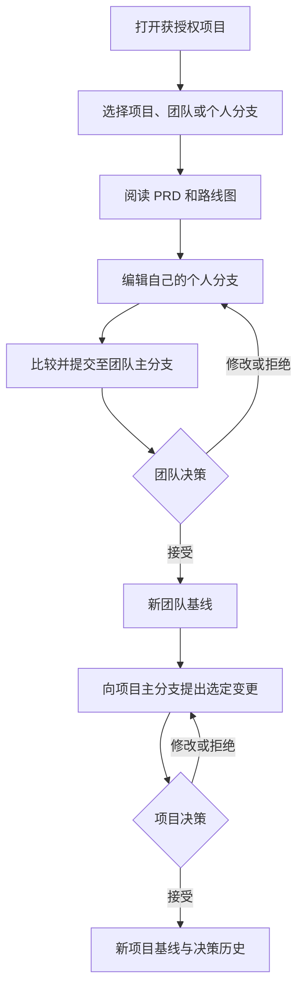
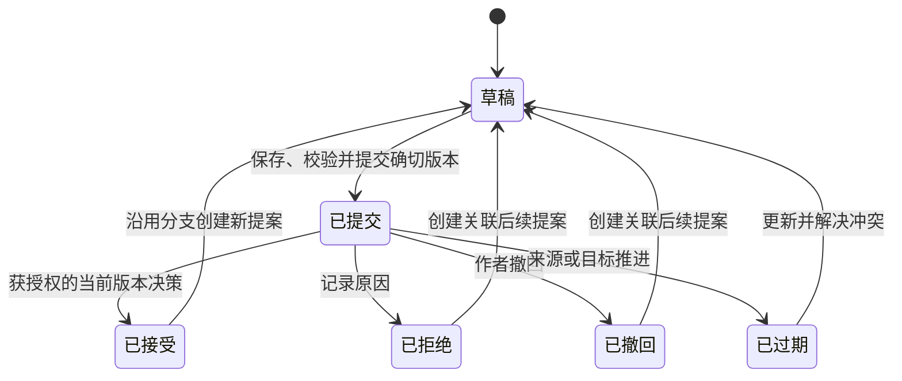

# Projects 产品需求

[English](PRD.en.md)

文档修订：3 · 更新日期：2026-11-20 · 应用发行版：0.2.0 · 原生及 Core SDK 实现验证已完成。

| 修订 | 日期 | 作者 | 变更 |
| --- | --- | --- | --- |
| 1 | 2026-11-19 | 产品负责人及维护智能体 | 确立项目、四个团队及个人计划分支。 |
| 2 | 2026-11-20 | 产品负责人及维护智能体 | 整理为可评审需求：角色、针对目标计划的提案、状态、校验、恢复与验收。 |
| 3 | 2026-11-20 | 产品负责人及维护智能体 | 明确受保护的角色分配、显式接受委托、身份分支、合成负载及本次先完整 P0 后 P1 的实现范围。 |

## 1. 概述：为什么做、为谁做

### 1.1 当前情况与预期成效

Projects 当前按独立空间管理项目目标、工作项、依赖及来源引用，已有原生阅读器、四个工作维度、签名业务操作、修订检查、幂等写入和变更事件。0.2.0 之前尚未实现下述计划分支、PRD／Roadmap 面板及提案接受；0.2.0 候选已实现这些合同及恢复为新草稿，验证范围见文末。本次先实现完整 P0 闭环，再完成 P1 恢复；功能声明须有 §5.1 的实际验收证据。

既有工作视图说明执行情况，但尚未提供共同的、可追溯版本的约定，以说明项目为什么存在、范围包含什么、团队承诺哪些里程碑。产品负责人要求一个项目主分支、四个团队主分支及个人分支。PRD 和 Roadmap（路线图）是主要计划面板，底层版本引擎提供比较、历史和受控变更。

预期成效是一份人人可查的共同计划，同时让成员及其获授权的智能体独立探索备选方案。常规起草、校验和比较应在既有授权内执行，不强制要求人工点击。涉及重要范围、承诺和接受的决策交给指定的业务决策者。打开页面不代表批准，单个负责人作出的决定也不能描述为全员一致。

| 目标 | 可观察成功标准 | 衡量边界 |
| --- | --- | --- |
| 理解当前约定 | 参与者能辨认当前项目／团队基线、负责人、承诺及未决问题。 | 验证代表性的阅读任务，不能从页面浏览推断理解。 |
| 变更计划时不默默丢失内容 | 独立提案保留无关变更；过期接受和未授权写入不产生变更。 | 发布前通过 §5.1 的全部必需验收案例。 |
| 减少协调成本 | 与原有流程比较每次被接受的计划变更所需人工处理时间，以及澄清／返工情况。 | 尚无实测基线或量化改善目标；先采集明确约定的试点基线，不虚构收益。 |

### 1.2 用户、术语与职责

目标用户包括项目决策者、科研／工程／市场／支持团队负责人、团队成员、读者，以及代表这些人操作的外部智能体。应用开发者、设计和测试人员据此文档实现并验证合同。

| 术语 | 含义 |
| --- | --- |
| 项目主分支 | 项目已接受的 PRD 和路线图，包含明确采纳的团队贡献。 |
| 团队主分支 | 一个团队已接受的计划，以及它与项目目标和约束的关系。每个项目恰有四个团队主分支。 |
| 个人分支 | 按项目、团队和已认证用户各自持续使用的草稿分支，用于隔离拟议变更。 |
| 基线 | 明确采纳、不可变的计划版本。空投影或尚未采纳的投影不代表已达成约定。 |
| 提案 | 针对明确目标计划的一组有界变更意图，包含来源依据、版本和影响。 |
| 接受 | 获授权的业务决策，将已审阅提案应用于目标并记录新基线。 |
| 执行事实 | 由应用持有的进展、已完成工作、交付或已记录验收，计划变更不能将其抹去。 |

层次是**一个项目主分支＋四个团队主分支＋实际个人分支**，不是总共四个分支，也不预设四个人。按照默认假设 A1（§5.2），同一人参与两个团队时，在这两个团队下分别拥有个人分支；个人身份来自认证，不来自输入的名字。

| 角色 | 在当前资源／操作授权内允许的行为 | 边界 |
| --- | --- | --- |
| 读者 | 阅读获授权的计划、比较和决策。 | 不写入草稿或基线。 |
| 团队成员 | 创建／复用和编辑自己的个人分支；提交或撤回自己的提案。 | 不编辑他人分支，不直接替换基线。 |
| 团队负责人或明确受托人 | 接受／拒绝以本团队为目标的提案；向项目主分支提出已接受的团队贡献。 | 不能仅凭团队负责人身份接受项目级变更。 |
| 项目决策者或明确受托人 | 采纳初始项目基线，接受／拒绝以项目主分支为目标的提案。 | 权限须针对该项目明确分配。 |
| 外部智能体 | 仅执行用户当前委派的操作；只有获得单独、明确的委派才可执行接受。 | 没有独立角色，不能自称负责人或管理者。 |
| 平台维护者／管理员 | 维护代码、部署及受保护的账号／权限控制。 | 平台身份本身不授予业务接受权。 |

接受既需要指定的目标决策角色，也需要当前限定范围的写入／接受授权，普通写权限本身不足以接受。角色分配必须受保护、可审计，不能夹带在提案中，也不能从旧有自由文本负责人标签推断。具体账号映射见 §5.2 的决策 D1。

## 2. 产品范围与整体流程

### 2.1 范围、优先级与发布边界

| 优先级 | 能力 | 交付状态 |
| --- | --- | --- |
| 既有 | 独立应用／原生渲染器；项目与工作项阅读；依赖、引用、修订／幂等合同；获授权的 Praxis 卡片和数据清单。 | 既有源码合同，须保留。 |
| P0 | 项目／四团队／个人层次；PRD 与路线图；按身份归属的草稿；面向父级目标的提案；比较、接受／拒绝／撤回／重新提交；冲突；不可变决策历史；授权与恢复。 | 实现已通过原生及 Core SDK 验证；部署和独立客户端另记。 |
| P1 | 将旧计划恢复为新草稿／提案，增强历史比较。 | 完整 P0 闭环之后的后续规划。 |
| 首版范围外 | 任意团队结构、任意分支图、为业务记录执行 Git 仓库操作、自动预留资源、自动回退现实操作。 | 不属于首版实现。 |

尚未确认实现发布日期或团队产能。当前任务实现 0.2.0，先完成完整 P0，再完成 P1；局部闭环不能算本次交付完成。历史源码发布或测试不能证明新功能已存在。

### 2.2 主流程与信息归属

从工作台打开获授权项目并选择分支，阅读对应 PRD 和路线图。如需变更基线，在相关团队下创建／复用自己的个人分支，保存草稿，检查目标变更及影响，再向该团队提交。团队接受后，团队负责人可将选定的项目级变更作为提案提交至项目主分支，由项目决策者审阅并接受或拒绝。

每个分支在自身范围内拥有独立的 PRD 和路线图。团队计划说明本团队如何贡献于项目目标，并保留团队特定上下文。**每个提案都描述对目标计划的变更。**个人→团队提案变更团队计划；团队→项目提案明确要变更的项目字段、目标、里程碑或承诺，并引用已接受的团队来源版本。不能用团队叙述替换整个项目 PRD。向上提升的团队条目保留带团队限定的稳定 ID 和来源记录。

同步父级上下文会更新继承的引用并揭示影响，不用项目叙述覆盖团队自己的计划。每个待处理提案明确记录其目标基线；分支的派生关系本身不授予合并权限。

Projects 持有计划、分支、提案和决策。既有工作项和引用操作继续作为执行记录的来源。被引用的 Knowledge 文档和交付物仍由所属应用持有，链接或提案不能扩大访问权限。Web 与 MCP 使用相同的类型化应用操作和授权规则。

### 2.3 状态模型与全局交互

分支跨多个提案持续存在，提案状态与分支身份分开。项目／团队面板展示只读基线；变更从成员个人分支发起，或从已接受的团队版本准备有明确范围的向上提案。

| 对象／状态 | 可见含义 | 允许的转换 |
| --- | --- | --- |
| 基线：未采纳 | 尚无已批准的初始计划。 | 具有目标授权的显式采纳创建首个基线。 |
| 个人草稿 | 已保存或未保存的工作均未改变基线。 | 校验后保存、比较、同步或提交。 |
| 提案：已提交 | 确切的来源／目标版本等待目标决策者处理。 | 接受、拒绝、撤回或标记审阅过期。 |
| 提案：已接受／已拒绝／已撤回 | 已记录的终态决策，内容和原因保持不可变。 | 可以创建关联的新提案，不改写旧决策。 |
| 审阅：已过期 | 提交／审阅后来源或目标发生推进。 | 更新比较，必要时处理冲突，再提交新的可审阅版本。 |
| 编辑器：未保存／保存中／已保存／冲突／结果不确定 | 本地持久化状态，与业务约定分开。 | 按 §3.6 恢复，不能把不确定保存标记为已接受。 |

每个来源／目标组合最多有一个活动提交。新提交版本替代先前审阅，但保留其依据。打开页面、轮询、切换面板或返回工作台，均不接受或完成业务对象。列表保持稳定身份和明确顺序；已保存里程碑使用其声明顺序，提案优先展示当前提交，历史按新到旧分页。数据到达不能移动键盘焦点或破坏编辑草稿。

## 3. 功能需求

### F01. 选择范围与采纳基线

**用户故事：**作为参与者，我需要知道正在阅读哪个项目／团队／分支，以便区分共同约定与个人提案。

原生项目入口及分支选择器展示项目主分支、恰好四个团队主分支（`research`、`engineering`、`marketing`、`support`）及当前授权内的个人分支。展示范围、分支所有者、父级／上下文版本、采纳状态和待处理变更。保留经过校验的项目／空间／分支／面板深链接，以及桌面和手机宽度下返回工作台的 Home 入口。分支名称不授予权限。

既有项目保留目标、工作项、依赖和引用。打开项目可以展示空的／未采纳的基线位置，但不写入记录，不虚构成员、个人分支、承诺或追溯性决策。初始采纳必须是明确获授权的操作，包含可审阅的初始内容及已记录决策。缺少决策授权时，基线保持未采纳并说明下一步，不能回退为依赖平台管理员身份。

### F02. 创建个人分支并维护其 PRD

**用户故事：**作为团队成员，我希望基于所选团队上下文拥有隔离草稿，以便提出变更而不修改团队已接受的计划。

为登录用户及获授权团队创建／复用分支，并记录父级上下文／版本。PRD 内容覆盖问题、成效目标、范围、不做什么、验收条件、未决问题、决策及来源引用。目标／条件使用稳定 ID，供路线图条目引用。草稿可包含不完整叙述，但须明确标为不完整。提交须提供目的、非空变更内容、目标和影响说明，并标识尚未解决的验收或承诺问题，供审阅。

编辑器标明编辑范围及基线，在字段旁展示校验信息，刷新／导航时保留变更，只有服务器确认后才显示保存成功。他人不能凭分支 ID 或设置负责人字段来编辑此分支。同一意图重复创建／保存只产生一个结果。采纳或接受基线时，问题和范围须非空，至少有一个目标及一项验收条件；可选的不做什么和未决问题可以明确保持未指定。删除最后一个必需条目的提案不能被接受。

### F03. 维护与 PRD 关联的路线图

**用户故事：**作为参与者，我希望阶段和里程碑关联目标与验收，以便理解日期和优先级的依据。

使用与 PRD 相同的分支／范围。里程碑展示标题、目标／条件、优先级、计划状态、负责人、依赖、已知计划日期，以及安排属于暂定还是已承诺。未知负责人／日期明确保持未知。计划日期不等于交付保证，`done` 计划标记也不能证明执行工作项或客户验收已经发生。

变更目标、范围或条件时，提交前展示对关联里程碑的影响。拒绝悬空的目标／条件／依赖引用及循环。已承诺里程碑须有承担责任的指派人、验收条件，以及对该承诺的明确决策授权；计划日期可以未知，但须如实显示。删除被引用的目标或里程碑时，须在同一拟议变更中更新依赖条目，不能默默丢弃关系。既有工作项状态保持不变，除非另行通过所属的获授权操作更新。

### F04. 比较、提交及决定针对目标计划的提案

**用户故事：**作为作者或目标决策者，我需要确切看见变更内容及原因，使接受建立在知情且可归责的基础上。

比较展示来源分支／版本、记录的目标基线、当前目标版本、新增／修改／删除，以及对目标、依赖、承诺和验收的影响。保留来源依据及未决问题。团队→项目提案选择项目级变更，未向上提升的团队细节仍留在团队计划中。空变更不能提交。基线创建是显式采纳，不是空合并。

提交冻结提案内容及已审阅的来源／目标版本。目标决策者可以接受或拒绝并记录原因，作者可以撤回。接受时在同一提交边界重新检查当前身份、委派、目标角色、资源／操作授权及双方版本。互不重叠的变更可以组合，但发布仍须经目标方获授权决策。提案不能修改成员关系、角色分配、他人个人分支或执行事实。

接受创建一个新的目标基线和一条持久决策，返回实际版本，并可在面板回读。拒绝／撤回不改变基线。后续编辑不能修改已接受／已拒绝快照；修订后的后续提案指向先前提案。用户可沿用既有个人分支，无须为每次变更创建新分支。

### F05. 解决冲突与同步上下文

**用户故事：**作为作者或获授权审阅者，我需要保留分歧双方内容，使并行工作不会被默默覆盖。

同一目标字段或稳定条目相对于记录的目标基线发生不兼容变更时，检测为冲突。展示基线、当前目标及拟议值与来源记录。独立变更保留双方内容。两个团队使用相同本地 slug 的条目，仍可通过团队限定身份区分。文本合并不能解决矛盾目标、产能承诺或验收规则，须记录未决问题、决策负责人及影响。

作者或获授权的目标维护者记录明确解决方案和原因。审阅者不会因此取得作者分支的直接编辑权，建议解决方案是一项新的可审阅变更。接受前更新目标／来源比较并重新提交。过期版本拒绝不写入基线。父级同步保留本地编辑及团队特定含义，标出冲突／影响，不能默默复制或丢弃内容。

### F06. 阅读历史与故障恢复

**用户故事：**作为参与者，我希望已接受计划及其背后的决策，在重试、重启或人员变化后仍能被解释。

保留已保存提案版本、已接受基线、决策、操作者、原因、来源／目标版本及依据引用。历史详情打开原始获授权 PRD／路线图版本。如实标识历史缺失及可变／未版本化来源，访问链接时重新检查当前来源权限。恢复旧计划（P1）创建新的个人草稿并遵循常规审阅，不回退执行事实，也不抹去中间决策。

| 情况 | 必需反馈与恢复 |
| --- | --- |
| 加载中或无计划 | 区分加载中与空／未采纳状态，提供获授权的下一步操作。 |
| 无效字段／引用 | 指明字段或关系，保留草稿并将焦点返回修正位置。 |
| 只读或缺少目标决策角色 | 保留允许的阅读，说明哪个操作不可用，不暴露不可访问的身份或计划。 |
| 权限撤销／会话过期 | 拒绝写入，停止后续读取，清除受保护界面内容及浏览器草稿缓存，并提供登录／访问恢复；服务端已保存分支及历史仍按应用保留策略保存。 |
| 尚不知已提交时发生网络故障 | 保留本地草稿，区分未保存与已保存。 |
| 超时／结果未知 | 标为结果不确定；通过同一获授权对象／意图回读，仅在需要时使用同一键重试完全相同请求，不能创建第二个意图掩盖不确定性。 |
| 来源／目标变化 | 展示过期／冲突状态，保留本地内容，更新并要求重新审阅。 |
| 带草稿刷新、切换分支或返回工作台 | 保留获授权草稿，或明确提供保存／放弃／留在当前页的选择，不能默默丢弃。本地草稿按身份隔离，在退出／撤权时清理。 |
| 父级／来源暂不可用 | 保持允许的已保存计划可读，标识不可用依据，阻止需要尚未验证版本的接受操作。 |

### 3.7 数据字典与校验

以下是 0.2.0 已通过类型化原生及 MCP 操作实现的产品字段规则。标明由服务端持有的标识和时间戳均不可编辑。服务端拒绝未知字段及无效类型；整条记录 JSON 替换不是业务操作。叙述使用纯文本，不是可执行 HTML 或代码。

| 对象／字段 | 类型与必填要求 | 规则／示例 |
| --- | --- | --- |
| 范围：`spaceId`、`projectId`、`branchId` | 必填稳定 ID | 在当前授权内解析；项目 ID 保留既有应用格式。 |
| 分支：`kind`、`teamId`、`ownerUserId` | 必填枚举；团队／所有者按类型可空 | `project`、`team`、`personal`；团队限四个固定维度；个人所有者为已认证用户。 |
| 分支／提案版本 | 必填、服务端持有的版本 ID | 区分来源头版本、记录的目标及已审阅目标；比较确切 ID，不比较日期。 |
| PRD：`problem`、`scope`、`outOfScope` | 纯文本；草稿可空 | 每字段最多 10,000 字符；已接受基线的问题／范围非空；可选的不做什么为空表示未指定。 |
| PRD：目标和条件 | 稳定 `{id,text}` 条目数组 | 各最多 100 项；文本 1–2,000 字符；条件到目标的链接须可解析。 |
| PRD：问题和决策 | 含文本、负责人／引用及状态的稳定记录 | 各最多 100 项，文本 1–2,000 字符；问题区分未决／已解决，负责人可未指派；已解决问题关联已记录决策，不虚构答案或负责人。 |
| 里程碑：`id`、`title`、目标／条件链接 | 提交时必填稳定 ID、标题及有效链接 | 标题 1–160 字符；向上提升时 ID 带来源团队限定；每分支最多 200 个里程碑。 |
| 里程碑：`status`、`priority`、`commitment` | 必填枚举 | 状态 `todo/doing/review/done`；优先级 `P0/P1/P2`；承诺 `tentative/committed`。仅描述计划。 |
| 里程碑：`ownerUserId`、`dueDate`、`dependsOn`、顺序 | 可空的获授权用户／日期、ID 列表、整数 | 日期为真实 `YYYY-MM-DD` 或 null；依赖唯一、最多 100 项、无自引用／循环；顺序为非负整数。 |
| 提案：目标和变更 | 必填范围、操作列表及来源引用 | 对允许的 PRD／里程碑条目执行 1–200 项有界操作，不接受任意路径；目标和来源保持在获授权层次内。 |
| 提案：目的、影响及决策原因 | 纯文本；提交时目的／影响必填，决策时原因必填 | 非空，各最多 2,000 字符；影响标识变更的承诺及未决问题。 |
| 依据引用 | 获授权对象引用，支持版本时附版本 | 不授予权限；未版本化来源须明确标识。 |
| 决策／历史：操作者、时间、结果和版本 | 必填、服务端持有的记录 | 保留原用户及受委派客户端引用，终态决策不可改写。 |
| 变更操作：预期版本和意图键 | 写入必填 | 同一意图使用稳定键，同键不同内容须拒绝。 |

文本校验拒绝不支持的控制字符。名称／ID 不能冒用角色。无效日历日期、越界枚举、未知链接、重复 ID 和超限内容均失败，不产生部分持久化。未保存草稿可以展示不完整字段，但已提交持久化的变更操作必须结构有效；已提交提案或已接受计划还须满足适用的关系和完整性规则。以下限制是发行版默认值，修改时须同步双语版本和验收数据。

## 4. 非功能需求

### 4.1 授权、存储与集成

由 Praxis 托管时保留独立 Projects 应用及其原生渲染器，保留既有工作视图、引用、逐项目深链接、语言选择和 Home 导航。所有项目及范围复用一个支持分支的渲染器和类型化数据。英文与简体中文产品文案一致，用户内容保留原语言。须支持键盘、加载／错误恢复及手机宽度。

业务私有存储由应用持有，位于 Git 和镜像之外。使用单个活动写入者，保证基线／决策原子持久化、持久幂等及可恢复的应用历史。物理表、索引及迁移设计属于实现方案。不能把现有私有数据引入测试，也不能以维护身份运行真实内容迁移。保留现有 schema 兼容性及已登记备份覆盖，不引入自动历史删除。适用保留／删除策略仍为 §5.2 的 D2。

原生 Web 和 MCP 须执行相同的有界操作、授权、版本和回读行为。公布新工具前，在 Projects 专用业务技能中记录各操作。当前操作名称不能证明拟议操作已存在。被引用应用不可用时，不能虚构已验证来源。保留应用持有的 Praxis 卡片与数据清单供数行为、原生路径、来源版本，以及空／部分失败／不可用区分；个人卡片选择不改变共同计划。

### 4.2 业务证据与衡量

记录分支创建、已保存提案版本、提交、决策、合并／冲突及恢复的权威生命周期。业务证据遵循项目授权下的保留／访问边界，关联真实操作者、来源／目标版本及安全决策引用。诊断聚合仅包含允许的操作类别、结果、耗时及不透明关联引用，不能包含 PRD 正文、原始参数、凭据、任意错误或私有阅读历史。

| 事件族 | 触发与允许记录的证据 | 用途 |
| --- | --- | --- |
| 分支／草稿 | 已提交的创建或保存；操作、版本及不透明引用 | 验证持久化／幂等。 |
| 提案 | 提交、撤回或替代；来源／目标版本及结果 | 解释审阅生命周期。 |
| 决策／合并 | 实际接受／拒绝决策或合并失败；目标／版本、结果及安全原因码 | 证明谁接受什么，检测被拒绝的过期写入。 |
| 失败／恢复 | 校验、拒绝、冲突或传输结果不确定；安全码及耗时 | 区分失败与业务提交。 |

不将浏览转化为已读回执或共识指标。可选的试点协调时间衡量须先约定方法和基线。提交、点击或批准次数不证明项目成功。

### 4.3 性能与可恢复性目标

已指定的合成目标 A2：对于四个团队、20 名活跃成员、所选分支有 200 个里程碑的合成项目，在指定测试环境测量常规计划读取／保存／比较的 p95 小于两秒；长历史加载通过分页单独测量。立即提供加载／处理中反馈，并允许从慢操作恢复。指定环境、实测结果与范围见文末，不构成生产服务保证。

服务重启后，已确认的计划保存、基线、终态决策及重试回执须保留。结果不确定时，在验证前持续明确标为不确定。授权变更于后续访问生效，过期缓存角色不能授权接受。

## 5. 附录：验收与待定事项

### 5.1 验收矩阵

文档修订 1–2 的全部新增案例均为 Pending，原始台账保留在 Git 历史中。修订 3 在下表记录实际实现结果；N/A 须有原因。使用隔离合成数据。真实独立获授权业务客户端及实体手机证据，依 Praxis 验证方案单独标识。

| ID | 优先级 | 案例与所需证据 | 当前结果 |
| --- | --- | --- | --- |
| AC01 | P0 | 既有项目读取保留目标、工作项／引用数据及原生导航；空安装不虚构记录或决策。 | Pass — 既有原生／供数测试及四个原生浏览器场景 |
| AC02 | P0 | 展示一个项目主分支、四个团队主分支及实际个人分支；同团队两位用户、同用户参与两个团队均保持区分。 | Pass — 原生身份／团队分支测试 |
| AC03 | P0 | 只读、成员、团队决策及项目决策身份执行角色／操作／资源矩阵；冒用、跨项目访问及撤销授权不产生写入。 | Pass — 原生授权／历史测试及实际 Core OAuth／PKCE SDK |
| AC04 | P0 | 创建／复用自己的分支，保存 PRD，关联路线图目标／条件，并在重启后回读确切保存版本。 | Pass — 原生重启／版本测试及 SDK 回读 |
| AC05 | P0 | 拒绝无效日期／枚举、未知或循环链接、重复 ID、未知字段、空提交及超限内容，无部分保存。 | Pass — 原生严格校验及无部分写入测试 |
| AC06 | P0 | 个人提案只改变所属团队目标，来源草稿不能绕过团队接受来修改项目主分支。 | Pass — 原生、四个浏览器场景及实际 SDK 闭环 |
| AC07 | P0 | 团队提案只向上提升选定项目变更及来源引用；项目 PRD 和无关团队上下文保持不变。 | Pass — 限定贡献提升及项目／执行事实保留 |
| AC08 | P0 | 两项独立提案保留彼此已接受变更；同条目不兼容变更展示基线／当前／拟议值，并要求记录解决决策。 | Pass — 原生独立／并发变更及浏览器三方恢复 |
| AC09 | P0 | 来源或已审阅目标改变后拒绝接受，不产生新基线；更新审阅后可以成功。 | Pass — 原生过期检查及 Core 角色／资源／委托撤销 |
| AC10 | P0 | 拒绝／撤回／替代／重新提交保留先前决策；已接受且持续使用的分支可以发起新提案。 | Pass — 原生不可变终态／后继／持续分支测试 |
| AC11 | P0 | 同一意图重复操作仅产生一个分支／保存／接受；同键不同内容失败；超时恢复先回读再完全相同地重试。 | Pass — 原生重试／重启、浏览器丢响应收据恢复及 SDK 回读 |
| AC12 | P0 | 刷新、分支导航、返回工作台、失去访问和退出登录覆盖草稿保留与受保护内容清理；私有草稿不跨身份。 | Pass — 原生浏览器草稿／导航／身份清理 |
| AC13 | P0 | 基线／历史保留操作者、原因、版本和获授权依据；缺失／未版本化来源有标识，执行事实不变。 | Pass — 原生不可变快照／受限角色审计及 SDK 历史 |
| AC14 | P0 | 工作台→Projects→分支→PRD／路线图→提案→父级基线→Home 流程在中英文、桌面和手机宽度可用，覆盖键盘及空／加载／错误状态。 | Pass — 英文／中文 × 桌面／390px 原生浏览器往返 |
| AC15 | P0 | 合成负载记录约定的 A2 环境、数据量和 p95；供数接口／既有视图检查保留当前集成边界。 | Pass — 20 客户端／20 成员／200 里程碑回环实测及供数回归 |
| AC16 | P1 | 将旧基线恢复为新草稿和普通提案；保留中间历史、已完成工作及交付。 | Pass — 原生、浏览器及实际 SDK 新草稿恢复且保留历史 |

### 5.2 待确认假设与决策

以下记录剩余选择及默认值，不索取真实账号姓名，也不授权维护会话创建业务记录。

| ID | 优先级 | 假设／决策与建议默认值 | 未确定的影响 |
| --- | --- | --- | --- |
| D1 | 0.2.0 已确认 | 仅当前业务空间 owner／admin 且具有项目范围 `manage_planning_roles` 的身份可分配／撤销项目决策、团队决策和团队成员映射。接收者须为已启用且当前可读项目的真实认证主体。接受另需 `update`、`accept_plan` 及确切目标的指定角色；OAuth 委托须明确包含 `accept_plan`。Core 仅从限定授权回调产生与请求正文绑定的 `rolesManage`、`subjectsChecked`、`actionsGranted` 签名事实，不信任输入中的自称角色。 | 平台管理员和旧 owner 文本无隐含接受权；未分配时保持未采纳，安装及读取不创建角色、成员或基线。 |
| A1 | 已确认 | 每个 `(project, team, 已认证 user)` 保留一个持续使用的个人分支；一人跨两团队有两个分支。 | 重试保持身份与分支唯一，不制造重复分支。 |
| A2 | 已指定合成验收环境 | Linux x86_64、Node 22.22.1 和 Node SQLite WAL；隔离回环服务与临时数据库；四团队、20 名合成活跃成员、所选分支 200 个里程碑，20 个并发客户端。分别测量读取／保存／比较 p95 与两秒目标，长历史单独分页测量。 | 指定夹具已测得读取／保存／比较 p95 730.60／149.89／96.10ms，见实现验证；不宣称生产 SLA 或协作收益。 |
| D2 | 保留／删除功能前确认 | 默认：按既有项目策略保留已确认计划／决策历史，不引入自动清理。另行明确所需保留期及成员离开后的访问。 | 阻塞自动历史清理，不阻塞常规版本保留。 |
| A3 | 已确认 | 本次 0.2.0 先完成完整 P0，再完成 P1 恢复为新草稿／提案。 | AC01–AC16 全部必需；局部原型或静默延后 P1 均不算完成。 |

### 5.3 文档交付证据

修订 1–2 仅改变文档。修订 3 对应 0.2.0 实现合同；从工作台阅读器验证双语，并分别记录实现、合成、浏览器及运行入口证据。§5.1 已记录实际功能结果，独立客户端／设备另列，维护不操作真实业务记录。

## 修订 3 的交付边界

修订 1–2 仅交付文档；修订 3 是 0.2.0 的实现合同。完整保留 F01–F06、AC01–AC16 和既有接口，按 P0→P1 顺序交付；通过工作台阅读器核对双语文档，分别记录源码、合成、浏览器、性能及运行入口证据。未实测前不把 Pending 写成通过。真实业务操作仅由独立获授权客户端执行，维护测试使用隔离合成记录。

## 0.2.0 实现验证

所属应用合成测试 52/52 通过，覆盖既有执行／供数及 AC01–AC11、AC13、AC15、AC16 的计划服务。真实原生 Chromium 在英文／中文、桌面／390px 四场景走通完整闭环，另核对 AC12／AC14 草稿恢复、版本冲突、角色管理、身份清理和 Home 往返。浏览器适配器使用合成网页登录会话，不能代替生产 Core／OAuth 或独立外部业务客户端证据。

Linux x64、Node 22.22.1、临时 SQLite WAL 的 20 客户端／20 成员／200 里程碑回环夹具测得 p95：读取 730.60ms、保存 149.89ms、比较 96.10ms。这是合成证据，不是生产 SLA。通过 `npm test` 复现；按说明配置 Playwright／浏览器后运行 `npm run test:browser`。Core 集成、源码发布及运行入口另由 Praxis 记录；维护未创建真实业务记录。

实际 Core HTTP 登录、显式同意、PKCE 换取令牌和 MCP SDK 调用，已针对真实签名 Projects 服务单独走通类型化 P0→P1。D1 覆盖不存在／已禁用／项目外主体、无指定业务角色的平台管理员、显式接受委托、角色／资源／委托撤销及实际版本回读。这些隔离 SDK 证据不是独立业务智能体 harness 或实体手机；后二者在 Praxis 独立验证方案中仍为 **Pending**。角色分配／撤销历史保留有界映射增量及实际操作者，映射增量仅对当前获授权的角色管理员可见。
